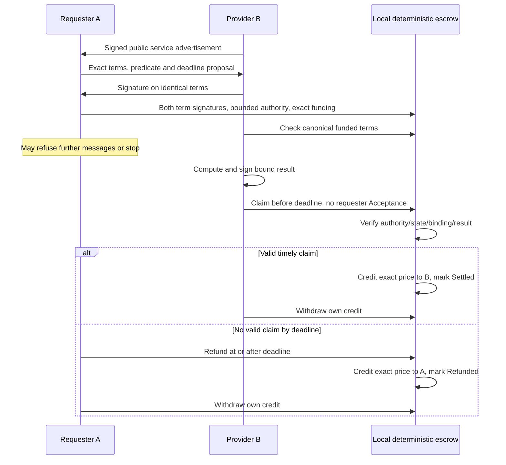

# Experiment 002 Proposal: Removing Requester Veto for a Directly Verifiable Service

**2026-10-18 — Accepted bounded local design after Task 008 review; READY for separate implementation authorization. No Experiment 002 implementation or results.**

## Research question and relationship to Experiment 001

Can a provider collect an explicitly preauthorized payment for a correct deterministic result without any requester message after funding? Compare against the published [Experiment 001 report](../../research/reports/EXPERIMENT_001_REPORT.md): **CONDITIONAL PASS**, 112 tests at its validation milestone, with requester-signed post-result Acceptance and an unresolved requester veto. That implementation, invariant assessment and evidence are preserved unchanged.

The [six-mechanism comparison](../../research/experiments/EXPERIMENT_002_FAIR_EXCHANGE_COMPARISON.md) recommends a direct deterministic predicate as the smallest bounded baseline. This is a proposed change of consent semantics for a separate experiment, not a fix silently applied to Experiment 001.

## Hypotheses and falsification

- **H2-A, conditional collectability:** after valid funding, a bound correct provider claim canonically included strictly before claimBefore credits exactly the agreed principal to the provider without a post-funding requester action. Requester refusal or shutdown cannot veto that transition.
- **H2-B, payment safety:** incorrect results, invalid signatures/bindings, replay, consumed/revoked first-use authority, expired actions and unauthorized callers cannot move principal contrary to the signed terms or exceed the spending cap.
- **H2-C, exclusive outcomes and conditional refund availability:** at most one terminal transition can occur. If still Funded at/after claimBefore, a live authorized requester can obtain a refund credit through a canonically included transaction; withdrawal requires its own successful transaction. With no live caller or no inclusion, a record may remain Funded indefinitely. Principal/credits are conserved; no automatic closure or unconditional refund liveness is claimed.

A counterexample inside the stated environment falsifies the corresponding hypothesis. Non-inclusion, reorganization, host failure or key loss must be separately recorded as outside a hypothesis premise or inconclusive execution; never discard these runs from the report. A deliberate result-leakage/censored-claim run should show that unconditional compensation and strong fair exchange are **not** established.

## Scope and non-goals

Two separate Python processes, distinct process-owned ephemeral keys, bounded signed local messages, synthetic principal and a temporary loopback chain. Use the same public service as the baseline: sum two uint64 operands, yielding a uint256 result with no overflow for those input bounds. Nominal inputs 7 and 11, result 18; price 10^12 synthetic wei, maximum 2 * 10^12, contract ceiling 10^15. These are local fixture constants, not tokenomics or measured costs. Planned arithmetic boundaries include zero and 2^64 - 1.

No useful-outsourcing, provider-effort, confidentiality, subjective AI quality, physical truth, economic sustainability, independent ownership/OS isolation, permissionless discovery, consensus, native-chain, native-asset or production-security claim. No AI calls, real funds, public RPC, external infrastructure or new cryptography. This test supports the broader Genesis research program; it does not define the final network.

## Method and reproducibility design

1. Preserve Experiment 001 as the immutable control at [f66cda9](https://github.com/Rotterdam-Autonomous-Systems-Lab/genesis/commit/f66cda91af5cb2f2da266fe11d90bc67c05cfc77); its existing refusal/refund test remains the baseline evidence. Run its current unchanged regression suite as well. Do not mix counts from the control and the new experiment.
2. After separate implementation authorization, add separate Experiment 002 components and a fresh contract/domain. Freeze exact reviewed tool/dependency references, commands, hash vectors and input fixtures before collecting results; existing pins are reference points, not automatically approved new dependencies.
3. Trusted harness starts temporary loopback Anvil, deploys the new component, and launches A/B with separate keys generated inside their processes. Signed discovery and dual-signed terms precede A's single-use bounded funding. B waits for confirmed funding, computes, signs and submits its claim without Acceptance. A independently recomputes observed results for evidence when online; its opinion cannot gate settlement.
4. Record canonical contract code/run identity, public message digests, distinct PIDs/addresses, transaction hashes, receipts/events, terminal state, exact credits/withdrawals and the independent harness result. Do not log keys or raw signed transactions. Receipt alone is insufficient when canonicality/accounting disagree.
5. Repeat at least two clean runs with fresh deployment/run IDs, then paired requester-refusal and requester-shutdown runs, rejection/refund cases and controlled faults from the [test plan](EXPERIMENT_002_TEST_PLAN.md). Use fixed input vectors and recorded fuzz seeds/budgets. Unresolved RPC responses block new sends until reconciled; record uncertainty explicitly.
6. Bound each process/RPC call and total run duration; clean up every child in success, exception and interrupt paths. Planned normal funding window is 120 chain seconds and claim window 300 chain seconds after deployment; boundary tests set exact timestamps. Planned wall-clock run budget is 120 seconds with individual RPC calls capped at 5 seconds. These limits are fixtures to review, not guarantees about real networks.

No execution script or implementation command for Experiment 002 exists yet. A later authorized task must publish tested fresh-checkout commands and locked versions before calling the design reproducible in practice. This document specifies the reproducibility requirements rather than inventing commands.

## Proposed protocol and security boundaries

Exact proposed behavior is in the [architecture](../architecture/EXPERIMENT_002_ARCHITECTURE.md), [threat model](EXPERIMENT_002_THREAT_MODEL.md) and [ADR 0002](../adr/0002-experiment-002-fair-exchange.md). A only funds/refunds, B only claims, each withdraws only its credit. No funded early cancellation or administrative override. Revocation affects unused authority only. Contract arithmetic is the settlement truth criterion; upfront A/B signatures consent to it. There is no challenge period or human dispute resolver in this baseline.

## Acceptance gate and reporting

Success requires every mandatory [test-plan](EXPERIMENT_002_TEST_PLAN.md) assertion to pass, reproducible paired controls, two fresh end-to-end runs, exact accounting, separate-process evidence, maintained Experiment 001 regressions, documented dependency review and an adversarial review of the implemented scope. Report measured gas, transaction counts, inclusion timestamps, wall time, payload sizes, attempted/successful attacks, total/repeated/inconclusive runs and all failures; no benchmarks exist yet. Gas is not a fiat cost and single-node latency is not a network benchmark.

**FAIL:** unauthorized/incorrect payout, requester veto of a timely valid funded claim, cap/replay/terminal-state/accounting breach, or claimed success without canonical payment evidence. **CONDITIONAL PASS:** all core safety/collectability/conditional-refund assertions hold but named noncritical evidence or coverage gaps remain, with reviewer rationale. **PASS within the bounded model:** all predeclared criteria and review gates are met; still not a strong-fairness proof or production approval. Missing mandatory safety tests or an untested core hypothesis cannot be hidden behind conditional acceptance.

Current assessment: **NOT EXECUTED**. [Task 006 design review](EXPERIMENT_002_DESIGN_REVIEW.md) amends closure/progress claims and keeps ADR 0002 Proposed. Next recommended task: specification finalization against review gates R1–R3, followed only by separate implementation authorization. No architecture is adopted by this specification.

## Task 006 vision alignment and progress evidence

The target research direction is an independent permissionless L1 economy where AI systems may earn native tokens through independently verified contributions and humans/machines share meaningful economic utility. This experiment addresses only a small service-settlement question. It supplies no native issuance, mining eligibility, useful-work uniqueness, consensus/Sybil resistance, sustainable demand or future-proofing evidence.

Separate valid-claim safety from provider progress: record canonical funding observation, first claim submission, canonical inclusion, credit and withdrawal, with remaining claim-time slack at each step. Report all attempted runs, including late funding, censorship, key loss, stalled actors and inconclusive outcomes. Never restrict the outcome denominator to already timely included claims. No numerical progress target for a real permissionless network is claimed.

## Task 007 exact specification and readiness

The [final technical specification](EXPERIMENT_002_FINAL_SPEC.md) is the current normative proposal for exact wire/type schemas, interfaces, state/accounting rules, deadlines and failure handling. See [public signature/state vectors](EXPERIMENT_002_SIGNING_VECTORS.md) and [dependency review](EXPERIMENT_002_DEPENDENCY_REVIEW.md). R2's schema/vector detail is supplied; readiness remains **BLOCKED** by B-DEP (reviewed exact dependency tuple or documented constrained reuse) and B-FEE (finite local operator gas-fee/run-cost policy). ADR 0002 remains Proposed; no Experiment 002 code, deployment or end-to-end evidence exists. Public data hash/recovery checks are not contract tests.

## Task 008 current readiness

[Blocker resolution](EXPERIMENT_002_BLOCKER_RESOLUTION.md) supersedes Task 007's BLOCKED status: B-DEP is resolved by constrained tested baseline reuse, and B-FEE by the [bounded-cost policy](EXPERIMENT_002_BOUNDED_COST_MODEL.md). ADR 0002 is Accepted for local design only. The [final specification revision 2](EXPERIMENT_002_FINAL_SPEC.md) is normative. Implementation and experimental acceptance remain separate; no general fair-exchange/native-economy result follows.
