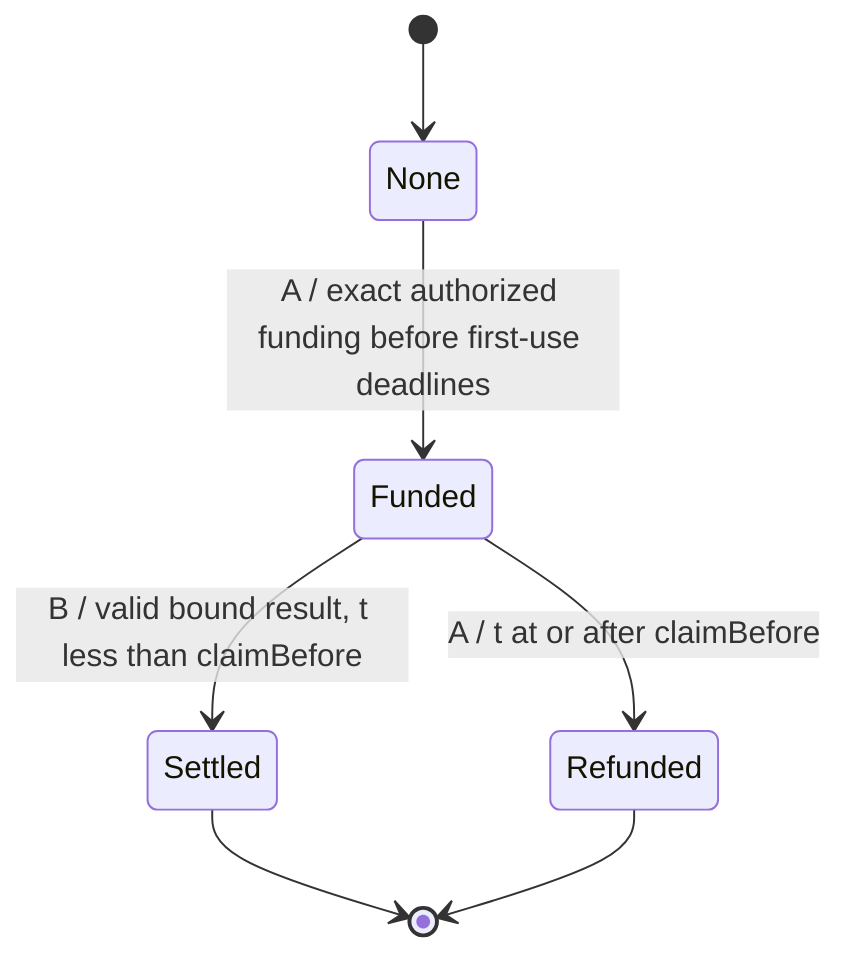

# Experiment 002 Final Technical Specification

**2026-10-18 — Specification revision 2 (Task 008); implementation readiness: READY for separate authorization. ADR 0002 is accepted for bounded local design only.** This document freezes intended semantics/interfaces and local budgets; it does not authorize code or claim they have been implemented. [Blocker resolution](EXPERIMENT_002_BLOCKER_RESOLUTION.md) and [bounded costs](EXPERIMENT_002_BOUNDED_COST_MODEL.md) document the reviewed dependency/risk and fee decisions. Read with the [architecture](../architecture/EXPERIMENT_002_ARCHITECTURE.md), [design review](EXPERIMENT_002_DESIGN_REVIEW.md), [threat model](EXPERIMENT_002_THREAT_MODEL.md), [test plan](EXPERIMENT_002_TEST_PLAN.md), [signature fixtures](EXPERIMENT_002_SIGNING_VECTORS.md) and [dependency review](EXPERIMENT_002_DEPENDENCY_REVIEW.md).

## 1. Research scope and consent

Test conditional collectability for public `uint64` addition after upfront dual-signed consent, without post-funding requester Acceptance. Separately test valid-claim safety, observed provider progress, conditional refund availability and withdrawal. No promise of compensation for all correct work, confidential/strong fair exchange, effort/unique contribution, subjective AI quality, sensor truth or decentralized liveness. Synthetic local funds only. This does not issue native tokens or select Genesis consensus/EVM architecture. The [Experiment 001 report](../../research/reports/EXPERIMENT_001_REPORT.md), code, 18-invariant assessment and requester-veto control remain unchanged.

R1's narrowed research question is specified and retained on its merits: the fixed verifier isolates the extra approval gate with no challenger/adjudicator/proof-system role. Task 008 accepts this scope for the local experimental design after compatibility and budget review; acceptance is not authorization to implement or a successful experiment.

## 2. Identities, domain and exact signed schemas

A=requester and B=provider, nonzero distinct EOA addresses with separate process-owned ephemeral keys. No contract-wallet signatures. A signs Terms and Authorization; B signs Advertisement, identical Terms and Claim. No key files, shared keys or RPC-unlocked signing. The trusted host/RPC remains able to compromise the fixture; process separation is not hostile-OS isolation.

Domain: `EIP712Domain(string name,string version,uint256 chainId,address verifyingContract)`, name `GenesisExperiment002`, version `1`, chainId from the actual local chain (fixture **31337**), verifyingContract the fresh deployment. Deployment has immutable nonzero `bytes32 runId`; every payload must match it. A fresh 32-byte random public run identifier is mandatory on each real fixture start; no reused deployment/run for a restarted chain. Same chain ID/address alone is not globally unique network identity. EIP-712 also cannot distinguish perfectly cloned ledgers with identical chain ID, address and run ID; trusted fixture setup/fresh-run checks are environmental assumptions, not cryptographic protection against such a clone. Non-EVM networks require separately specified authentication/network identifiers, not automatic signature portability.

Exact ordered EIP-712 type strings (field order and widths are normative):

```text
Advertisement(address provider,bytes32 serviceId,bytes32 policyId,uint256 price,uint64 offerExpiresAt,bytes32 runId)
Terms(address requester,address provider,bytes32 serviceId,bytes32 policyId,uint64 x,uint64 y,uint256 price,uint64 fundBefore,uint64 claimBefore,bytes32 salt,bytes32 runId)
Authorization(address requester,address provider,bytes32 agreementId,uint256 nonce,uint256 maxAmount,uint64 expiresAt,bytes32 runId)
Claim(address requester,address provider,bytes32 agreementId,uint256 authorizationNonce,uint256 value,bytes32 runId)
```

`SERVICE_ID = keccak256(UTF8("genesis.sum-u64.v1"))`; `POLICY_ID = keccak256(UTF8("genesis.exp002.direct-sum-u64.v1"))`. Both are immutable constants. `agreementId` is the complete EIP-712 Terms digest, not its JSON hash or struct hash alone. Use standard ABI encoding for the typed struct hash, standard EIP-712 domain separation and established ECDSA recovery. Supported signature is exactly 65 bytes, nonzero r/s, low-s, v=27/28; reject other lengths/encodings and wrong recovered signer. No personal-sign substitute, compact signature or dynamic verifier callback.

Wire messages are UTF-8 JSON objects with precisely the declared schema fields plus the corresponding signature(s); duplicate/unknown fields, floats, booleans for integers and nested unexpected payloads are rejected. All integer values are canonical base-10 strings (`0` or nonzero digit followed by digits), range-checked against their declared unsigned widths. Addresses are lowercase `0x` plus 40 hex digits, bytes32 are lowercase `0x` plus 64, signatures lowercase `0x` plus 130. Canonical file serialization uses sorted object keys, no insignificant whitespace and no NaN; JSON order never determines signed hashing. Limit each public envelope to 16 KiB. The JSON fixture container's explanatory metadata is not a transport schema.

For finalized signed envelopes use `kind` equal to `advertisement`, `terms`, `authorization` or `claim`, `message` containing exactly the corresponding typed fields, and `signatures` containing respectively only the `provider` key, both `requester` and `provider` keys, only `requester`, or only `provider`. Negotiation uses a fifth envelope `kind=termsProposal`, the exact Terms message and only the requester signature. B validates A's proposal against its offer, then signs precisely that message and publishes the dual-signed `terms` envelope; any alteration requires a fresh proposal/signatures. A verifies both before signing Authorization/funding. Authorization transport is optional public audit evidence and never permits B or a third party to fund. Only canonical funding permits B to start work. Domain values come from independently checked local configuration/deployment, never untrusted message overrides. A/B verify the Advertisement's B signature, service/policy/run, price and `now < offerExpiresAt` before accepting terms/funding. The contract validates dual-signed Terms; discovery advertisements confer no spending or settlement authority.

## 3. Contract interface and evidence

Proposed deployment constructor takes only nonzero `bytes32 runId`; no admin, upgrade, token, external oracle or replaceable verifier. Use the Terms/Authorization/Claim structs above. Interfaces for the future implementation:

| Function | Caller / purpose |
| --- | --- |
| `fund(Terms,Authorization,bytes requesterTermsSig,bytes providerTermsSig,bytes authorizationSig) payable` | A only; exact principal, new obligation. |
| `claim(Claim,bytes providerClaimSig)` | B only; fixed predicate settlement credit. |
| `refund(bytes32 agreementId)` | Stored A only, after claim window. |
| `revokeUnused(uint256 nonce)` | Caller revokes its own unused authority. |
| `withdraw()` | Caller withdraws its entire own credit; no alternative payee. |
| `verifyResult(uint64 x,uint64 y,uint256 value) pure returns (bool)` | Public read-only fixed relation; contract uses the same immutable relation directly in claim. |
| `getRecord(bytes32 agreementId) view returns (Terms,uint256 authorizationNonce,State,uint256 result)` | Exact stored evidence; None returns zero-valued fields. |
| `nonceStatus(address requester,uint256 nonce) view returns (NonceStatus)` | Unused=0, Consumed=1, Revoked=2. |
| `credits(address)`, `lockedPrincipal()`, `totalCredits()`, `runId()` | Read-only accounting and run identity. |
| `SERVICE_ID()`, `POLICY_ID()`, `MAX_AMOUNT()` | Read-only constants; MAX_AMOUNT=10^15 synthetic wei. |

State enum: None=0, Funded=1, Settled=2, Refunded=3. Result is persisted on successful claim (including zero); State distinguishes accepted zero from absent result.

Required events:

```text
Funded(bytes32 indexed agreementId,address indexed requester,address indexed provider,uint256 authorizationNonce,uint256 price)
Claimed(bytes32 indexed agreementId,address indexed provider,uint256 authorizationNonce,uint256 value,uint256 price)
Refunded(bytes32 indexed agreementId,address indexed requester,uint256 authorizationNonce,uint256 price)
Withdrawn(address indexed owner,uint256 amount)
AuthorizationRevoked(address indexed requester,uint256 nonce)
```

Client success requires the expected receipt status, exact emitting contract/event/fields, canonical block hash and transaction membership, matching immutable terms/terminal state/result/credits and exact withdrawal/accounting deltas. An event or peer status string alone is insufficient. Runtime code hash must equal the locally compiled/deployed artifact with immutable run ID applied; record actual artifact/compiler hashes per run. No hardcoded code hash exists before implementation. One-block Anvil observation is a fixture convention, not decentralized finality.

## 4. Funding, authority and state transitions

All failed checks revert atomically, with no escrow/credit/authority-state change or protocol event. EVM transaction nonce/gas can still be consumed by a mined revert; distinguish that nonce from the signed Authorization nonce. Error selectors/revert text are not a security predicate and may differ; tests must check outcome and unchanged state, not one assumed validation order.

Funding requires A caller; exact signatures and all party/agreement/run/service/policy bindings; new agreement; A's nonce Unused; `0 < price <= maxAmount <= MAX_AMOUNT`; `msg.value == price`; and canonical timestamp `t < expiresAt <= fundBefore < claimBefore`. Salt is a signed arbitrary bytes32, not a substitute for a nonce. No minimum funding-to-claim slack or grace period is added. Fund atomically stores Terms and auth nonce, consumes nonce and increases locked principal by price. Third-party funding, overpayment, underpayment and duplicate funding reject. An already consumed nonce cannot fund another agreement; a new nonce cannot reopen the same agreement.

The network may reject insufficient balance for value plus gas before execution; never invent a successful receipt. A canonically reverted transaction leaves contract state unchanged. An ambiguous RPC response is pending/unknown until reconciled, not proof that funds were insufficient or nothing happened. Off-chain funding preflight never replaces contract checks.

`revokeUnused` maps only caller-owned Unused -> Revoked. Consumed/Revoked reject. Revoke then fund rejects; fund then revoke rejects and preserves the funded obligation. First-use expiry does not cancel an already funded record. Refund never restores authority. No early funded cancellation or unilateral terms edit.



Invalid attempts remain in their prior state. With no valid included caller action, Funded can remain Funded indefinitely, including after the deadline. Terminal transitions create a credit; withdrawal is a separate operation, not another agreement-state transition.

## 5. Verification, settlement and accounting

Only one supported result type: unsigned uint256 representing `uint256(x) + uint256(y)` for stored uint64 operands. Supported maximum is `2^65 - 2`. No bytes blob, float, arbitrary program, AI evaluation, external data or submitted “verified” flag. `verifyResult` returns true iff that relation holds. Validity is independent of provider reputation and requester opinion. Checking is fixed-size arithmetic, hashing/signature recovery and mapping operations per record; no work-dependent loops/arrays, arbitrary callback or externally chosen verifier. Actual gas must be measured on the selected compiler; no numeric gas benchmark is claimed.

Claim requires caller=stored B, State=Funded, `t < claimBefore`, matching signed Claim fields/consumed auth nonce, and fixed correct value. Atomically store result, reduce locked principal by price, add price to B credit/totalCredits and mark Settled. A cannot veto or later cancel; A also cannot authorize an invalid sum to bypass the checker. Anyone copying B's public proof cannot submit as B or redirect payment. B signature proves authorship/consent, not computational effort or exclusivity.

Refund requires stored A, State=Funded and `t >= claimBefore`; reduce locked principal, add exactly price to A credit/totalCredits, mark Refunded. Full refund only; no gas/effort compensation, disputes or partial payments. Claim at equality rejects; refund at equality succeeds. Execution order, not send time or local completion, determines validity. At most one terminal outcome. Late funding may be valid yet leave B unpaid; report this rather than extending deadlines.

Withdraw requires positive caller credit; zero it and decrease totalCredits before transfer; on failure revert all changes. Use an established non-transient reentrancy guard on state-changing entry points. Ordinary receive/fallback transfers reject; forced native transfers remain possible surplus. `balance >= lockedPrincipal + totalCredits`; aggregate liabilities must equal per-record locked principal plus per-owner outstanding credits. Surplus changes neither authority nor entitlement and has no recovery path. Withdrawal of aggregated credits is permitted; tests reconcile multiple agreements. Gas is separate from principal and must not be mistaken for an accounting loss.

## 6. Agents, failures and bounded recovery

Signed discovery/terms -> A funding -> B canonical funding check -> B computation/claim -> own-credit withdrawal. A independently recomputes output when online, but no post-funding A signature is needed. Harness recomputes in all successful fixture cases, including requester shutdown. Distinct PIDs and public addresses, no shared in-memory state, fixed bounded regular-file transport and atomic no-clobber publication. Existing Experiment 001 components may inform a later implementation but must not be modified to change that experiment's consent rule.

Baseline local timing remains fundBefore=t0+120, claimBefore=t0+300; test fixtures deliberately include other signed boundary/late terms. Per-call timeout 5 seconds, wall-clock run cap 120 seconds, finite polls, message cap 16 KiB, at most eight submission attempts per agent and at most 2,000,000 gas units per transaction (existing fixture ceilings). No automatic transaction replacement or fresh-nonce retry. The independent operator policy caps maxFeePerGas at 3,000,000,000 and maxPriorityFeePerGas at 1,000,000,000 synthetic wei/gas. Deployer has one attempt/6*10^15 fee budget; A and B each have eight attempts/48*10^15 fee budget. Reserve closing slots, charge worst-case budget before signing and allow no top-ups/automatic fee escalation. See [bounded costs](EXPERIMENT_002_BOUNDED_COST_MODEL.md), including 15-second cleanup, local resource measurements and all assumptions. Principal cap alone does not bound gas.

Before signing, check literal loopback RPC, chain ID, run ID, compiled/deployed code identity and exact unchanged terms. Disable CCIP Read/proxy/redirect fallback; no public fork, external API/model call or unrestricted shell execution. Record signed transaction hash/intent in memory before send; log only public hash. Timeout after possible broadcast latches uncertainty. Reconcile canonical receipt/state/nonces/credits; if unresolved or contradictory, block new sends and label the run inconclusive. No signed-transaction bytes or private keys are retained in public artifacts. Crash/key loss can prevent refund/withdrawal; do not reset accounting to fabricate progress.

Requester refusal/shutdown after funding does not block a timely B claim. Disclosure, censorship, provider absence, deadline expiry or rollback can still leave correct work unpaid. No caller means no automatic refund. Separately authorized agreements may pay for identical inputs/results; replay prevention is not global work uniqueness or a mining rule. Test all these limitations explicitly. Cleanup runs on success/exception/interrupt; SIGKILL/host failure cannot guarantee application cleanup. Trusted time advance is allowed in deadline tests and must be recorded; it must not alter signed deadlines or masquerade as real-network latency.

## 7. Concrete vectors and acceptance criteria

[Public signing vectors](EXPERIMENT_002_SIGNING_VECTORS.json) freeze seven signed agreement/auth/claim fixtures, four additional signed artifacts and five invalid mutations. The [vector guide](EXPERIMENT_002_SIGNING_VECTORS.md) specifies expected states at exact timestamps and replay/revocation orders. Data encoding/hash/recovery was checked locally; **no Experiment 002 contract or end-to-end test has executed**. Later implementations must verify these constants independently in Solidity and Python, not import expected outcomes as truth.

Mandatory acceptance: all P2-01–P2-16 mapped to implemented evidence; T01–T20 and vector cases pass without weakening Experiment 001; two fresh normal runs plus refusal/offline-provider-collection controls; invalid inputs/signatures/results never pay; no replay/over-cap/unauthorized transition; exclusive refund rules and conserved accounting; canonical settlement plus successful withdrawal; bounded cleanup/recovery; declared fuzz 256 and stateful 128 x 64 budgets; reviewed exact tool/lock hashes; fresh-checkout commands and passing CI. Report every attempted/inconclusive run and funding/submission/inclusion/credit/withdrawal timing/slack. Exclude gas from principal deltas, but report gas costs and bounded fee policy separately.

Any in-model unauthorized payout, invalid result paid, duplicate obligation/payment, conflicting terminal transitions or requester veto of an otherwise valid timely included claim is FAIL. Missing mandatory safety evidence blocks acceptance. Conditional outcomes must name noncritical gaps; no acceptance label establishes formal proof, production security, fair exchange, native economy or consensus.

## 8. Readiness and accepted constraints

**B-DEP RESOLVED:** [Task 008 selection](EXPERIMENT_002_BLOCKER_RESOLUTION.md) adopts the existing exact tested tuple for disposable local-only use with explicit advisory/compiler/runtime/installer residual risks and source restrictions. No Experiment 001 dependency change follows. New source/features/closures must satisfy those restrictions and be tested; otherwise reopen the decision.

**B-FEE RESOLVED:** the [operator cost model](EXPERIMENT_002_BOUNDED_COST_MODEL.md) bounds principal, per-role fee attempts/reservations and runtime separately. Combined fees <=102*10^15 synthetic wei, plus a single principal P<=10^15; role-wallet initial supply <=103*10^15 with no top-ups. These limits assume the specified honest signer/host and ledger behavior; they are not universally enforced by escrow or proof of inclusion.

ADR 0002 is **Accepted for bounded local experimental design**. Readiness is **READY for a separately authorized implementation**, not implemented, deployed, audited, or experimentally accepted. Keep exact schemas/vectors, all P2/T01–T20/fee controls, source review, gas measurement and unchanged Experiment 001 regressions as mandatory acceptance gates. Deployment exceeding its two-million-gas ceiling must fail or trigger explicit review, not an automatic increase. No open material design decision remains in the scoped local proposal; broader fairness, useful work, consensus, native economics and adoption remain unresolved research.
